# Guion del video EP3 — Sonido Vivo

Duración objetivo: **6–7 minutos**. Una sola toma por bloque; si te equivocas, corta y sigue
desde el bloque. Las capturas son del sistema real corriendo el 26/11 (React + 3
microservicios + MariaDB de XAMPP).

Lo que la pauta exige que se vea: **integración React–Spring Boot, CRUD, persistencia,
login JWT, sesión, restricciones por rol**. Cada bloque dice qué indicador cubre.

## 0. Antes de grabar (checklist)

1. XAMPP: **MySQL** y **Apache** en *Start* (Apache solo para mostrar phpMyAdmin).
2. Los tres microservicios, **de a uno** (si arrancan juntos, Maven choca al descargar):
   `cd backend\ms-usuarios` → `.\mvnw.cmd -s ..\settings-google.xml spring-boot:run`,
   esperar "Started", luego `ms-productos`, luego `ms-pedidos`.
3. `cd frontend` → `npm run dev`.
4. Chrome en ventana normal (no incógnito), zoom 100 %, sin otras pestañas. Abrir
   DevTools (F12) → pestaña **Network**, filtro **Fetch/XHR**, y acoplarlo abajo.
5. Base limpia: 51 productos, GA001 con stock 8, sin pedidos (ya quedó así).
6. Pestañas preparadas: `localhost:5173`, `localhost:8081/swagger-ui.html`,
   `localhost/phpmyadmin`, y VS Code con `frontend/src/services/api.js` abierto.

## 1. Presentación — 20 s

**Pantalla:** inicio de la tienda.

> "Soy Sol León, sección 005D. Este es Sonido Vivo, una tienda de instrumentos. El
> frontend es React con Vite y Tailwind, y el backend son tres microservicios Spring Boot
> —productos, usuarios y pedidos—, cada uno con su base de datos en MySQL de XAMPP."

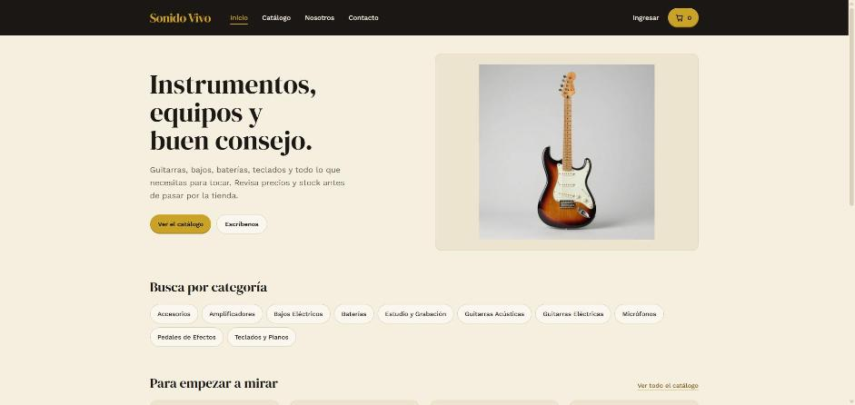

## 2. Arquitectura en el código — 40 s · *integración*

**Pantalla:** VS Code, `frontend/src/services/api.js`, y la carpeta `backend/` abierta.

> "Toda la comunicación pasa por `api.js`: es el único archivo que llama a `fetch`.
> Agrega el token en el header `Authorization: Bearer`, y si el backend responde 401
> borra la sesión. Las páginas nunca llaman a fetch, usan los servicios."

Mostrar en `backend/`: los tres `ms-*`, y en uno las capas `controller / service /
repository / model / dto / security`.

## 3. Catálogo público desde la API — 30 s · *integración*

**Pantalla:** `/catalogo` con DevTools Network abierto.

> "El catálogo es público. Los 51 productos vienen de `GET localhost:8081/api/productos`,
> sin token." → hacer clic en la petición en Network y mostrar la respuesta JSON.
> Filtrar por una categoría (chip) y mostrar que cambia a `?categoria=GA`.

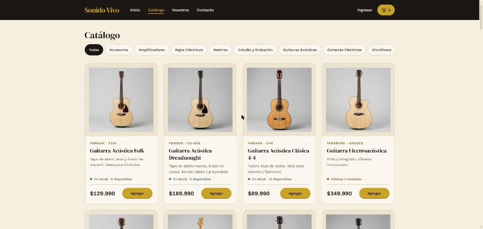

## 4. Ruta protegida y login JWT — 50 s · *autenticación JWT*

**Pantalla:** escribir a mano `localhost:5173/mis-pedidos` sin sesión.

> "Si intento entrar a Mis pedidos sin sesión, `RutaProtegida` me manda al login."

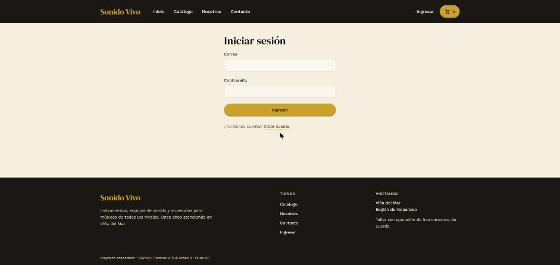

Ingresar `cliente@correo.cl` / `Cliente123`.

> "Al iniciar sesión, React hace `POST /auth/login` a ms-usuarios, que valida la contraseña
> con BCrypt y devuelve un JWT firmado con el correo, el rol y el vencimiento." → mostrar en
> Network la respuesta con `token` y `rol`. Volvió solo a /mis-pedidos.

> Opcional (suma mucho): DevTools → Application → Session Storage: mostrar la sesión
> guardada. Copiar el token y pegarlo en jwt.io para mostrar `rol: CLIENTE` y `exp`.

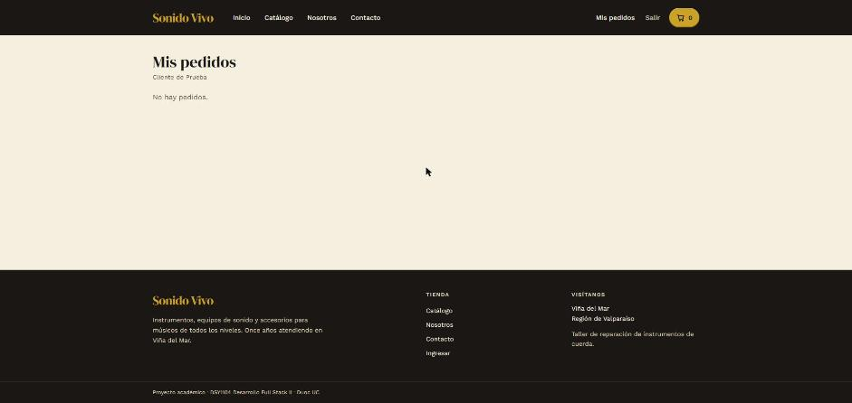

## 5. Compra que persiste y descuenta stock — 60 s · *CRUD + persistencia*

1. Abrir la ficha de **Guitarra Acústica Folk** → mostrar **"8 disponibles"**.
2. *Agregar al carrito* → carrito → *Comprar*.

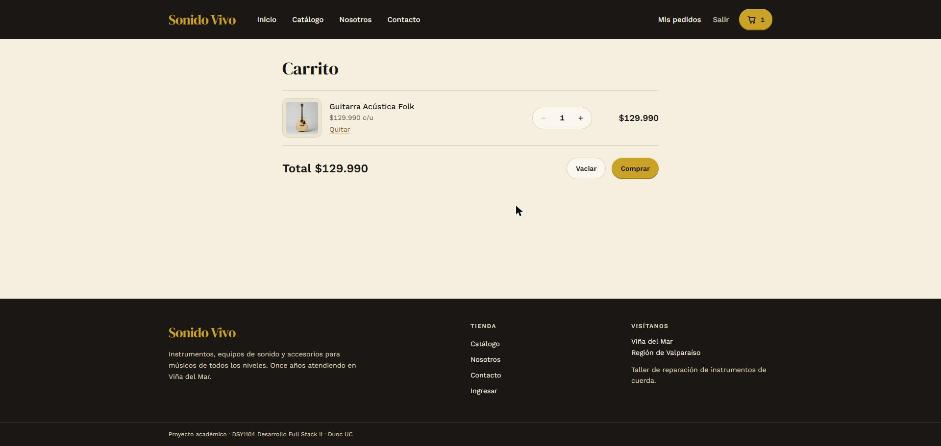

3. Nombre "Cliente", Apellidos "de Prueba", **Retiro en tienda** → *Pagar*.

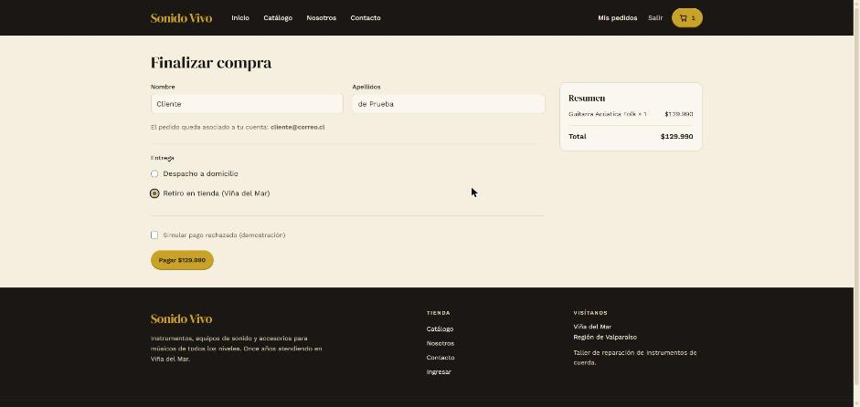

> "El pedido va a ms-pedidos con el token del cliente. Solo mando códigos y cantidades:
> el precio lo pone el servidor. ms-pedidos llama a ms-productos con un token propio de rol
> SERVICIO para descontar el stock."

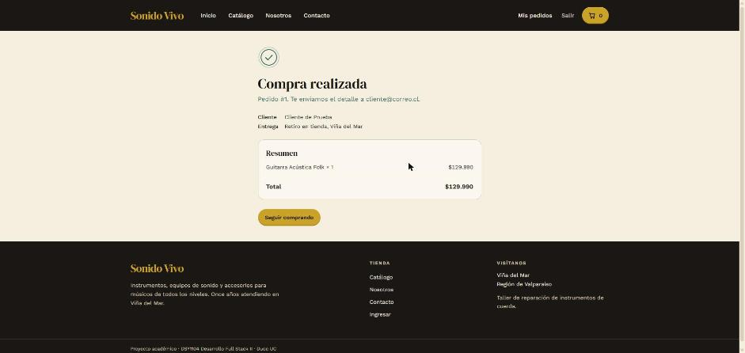

4. Volver a la ficha: ahora dice **7 disponibles**.

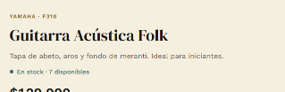

## 6. La sesión sobrevive a F5 — 20 s · *sesiones*

**Pantalla:** `/mis-pedidos` → apretar **F5**.

> "Recargo la página y la sesión sigue: el token está en sessionStorage, y `RutaProtegida`
> lo valida con `GET /auth/me` antes de mostrar la página. Si estuviera vencido o
> alterado, me manda al login." → en Network se ve la llamada a `/auth/me`.

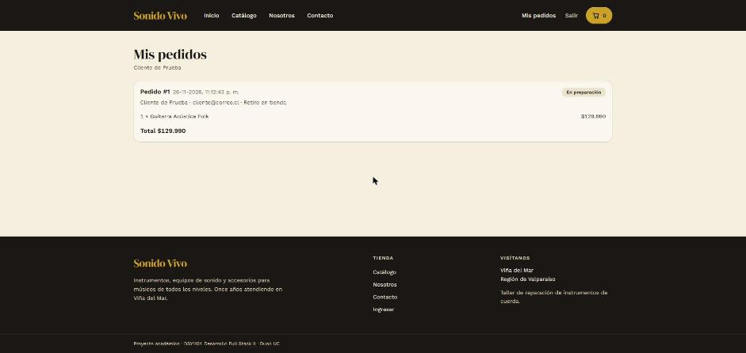

## 7. Restricción por rol: cliente — 30 s · *roles (frontend + backend)*

Escribir a mano `localhost:5173/admin/productos`.

> "Un cliente no puede entrar al panel: React muestra Acceso restringido."

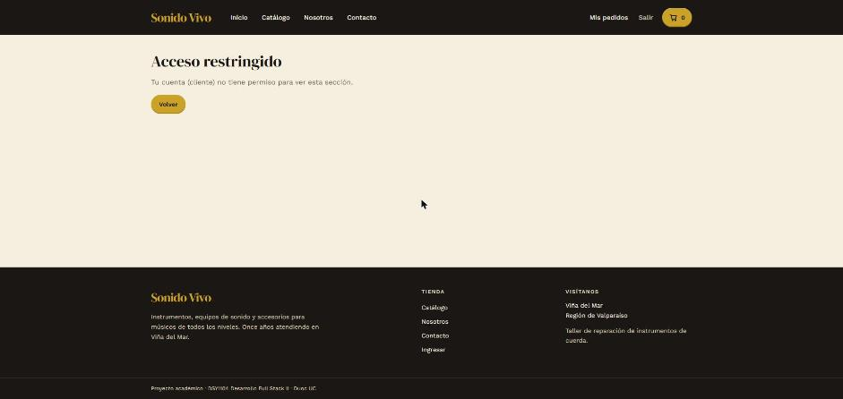

> "Pero la protección real está en el backend." → en Swagger de ms-productos (8081),
> *Authorize* con el token del cliente, `DELETE /api/productos/GA001` → **403
> `{"error":"Sin permisos"}`**. Sin token (*Logout* en Authorize) → **401
> `{"error":"No autenticado"}`**.

## 8. Vendedor: gestiona pedidos, nada más — 40 s · *roles*

*Salir* → login `vendedor@sonidovivo.cl` / `Vendedor123` → llega a **/admin/pedidos**.

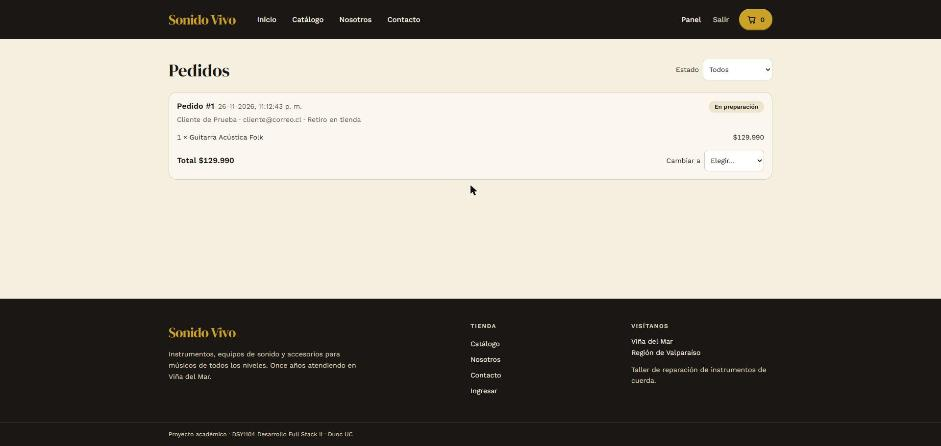

Cambiar el pedido #1 a **Despachado**.

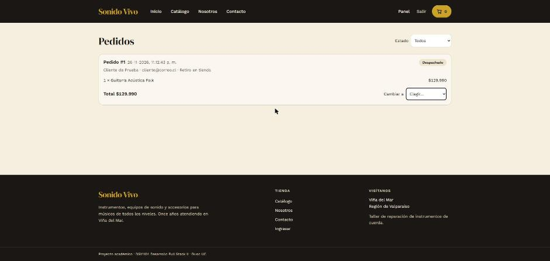

> "El vendedor ve y cambia el estado de todos los pedidos. Si cancelara uno, ms-pedidos
> repone el stock." Luego escribir `/admin/usuarios`:

> "Pero no puede gestionar usuarios ni productos: eso es solo del administrador."

## 9. Administrador: CRUD de productos con validaciones — 75 s · *CRUD*

*Salir* → login `admin@sonidovivo.cl` / `Admin123` → llega a **/admin**.

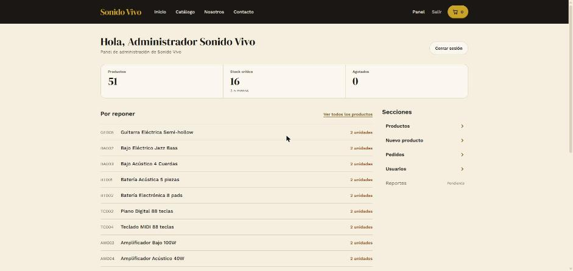

1. **Crear:** *Nuevo producto* → apretar *Guardar* vacío.

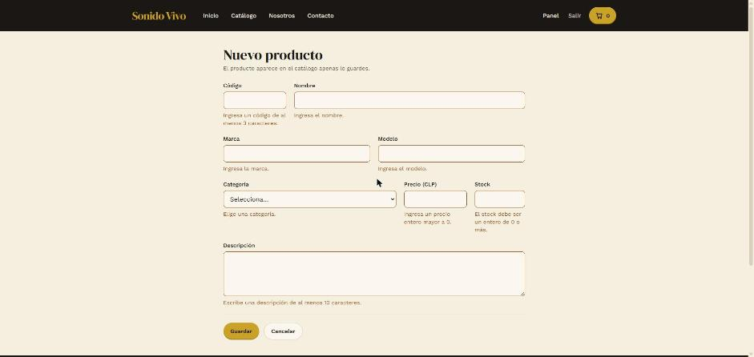

> "React valida antes de enviar. Y el backend valida de nuevo con Bean Validation: si
> alguien salta el frontend recibe 400 con el error de cada campo."

   Llenar: `GA010`, *Guitarra Clásica de Estudio*, Yamaha, C40, Guitarras Acústicas,
   99990, stock 4, descripción → *Guardar*. La lista pasa a **52 productos**.

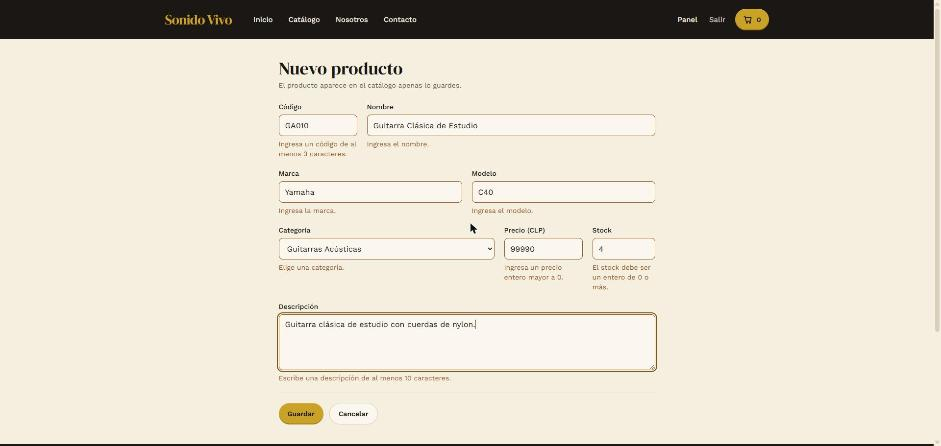
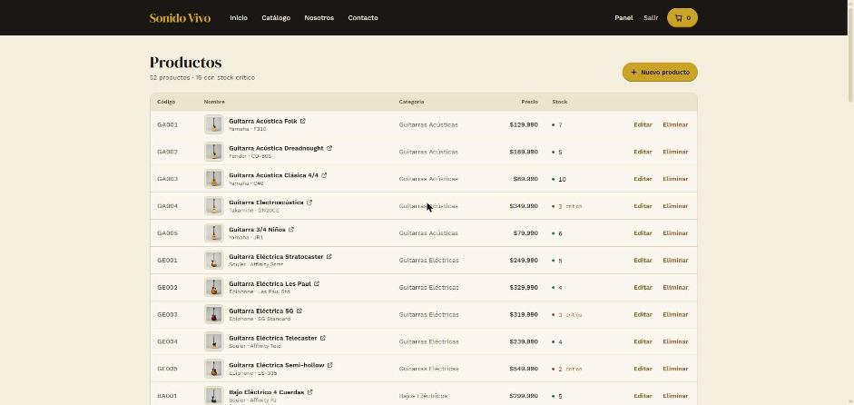

2. **Editar** GA010: cambiar precio a 94990 → *Guardar* → se ve en la tabla.
3. **Eliminar** GA010 → confirmar → vuelve a 51.

> En Network: `POST`, `PUT` y `DELETE` a `:8081/api/productos` con `Authorization: Bearer`.

## 10. Persistencia en MySQL — 30 s · *persistencia*

**Pantalla:** phpMyAdmin → `sonidovivo_pedidos` → tabla `pedido` (el pedido #1,
DESPACHADO) y `sonidovivo_productos.producto` (GA001 con stock 7).

> "Todo queda en MySQL. Cada microservicio tiene su propia base: no comparten tablas,
> se comunican por REST. Si reinicio los servicios, los datos siguen."

Opcional: `sonidovivo_usuarios.usuario` → la columna `password` es un hash BCrypt.

## 11. Swagger — 20 s · *documentación de la API*

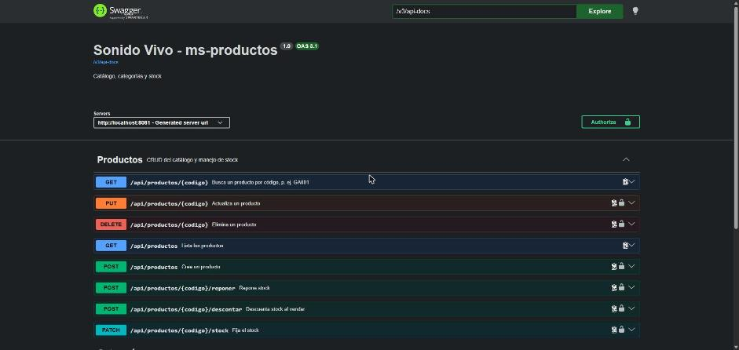
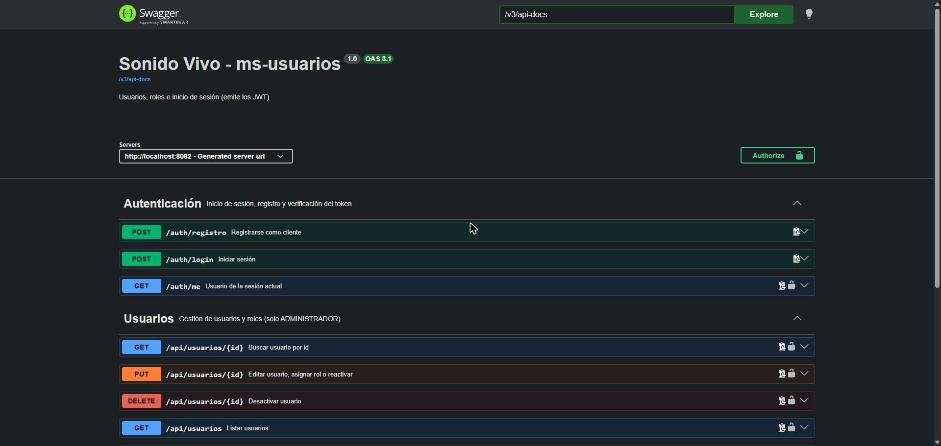

> "Cada microservicio documenta sus endpoints en Swagger, con el botón Authorize para
> probar con un token. Los candados marcan los que exigen sesión."

## 12. Cierre — 15 s

> "En resumen: React consume tres microservicios Spring Boot por REST, con JWT, roles
> validados en el backend y datos persistidos en MySQL. Los repositorios del frontend y
> del backend tienen las instrucciones para ejecutarlo. Gracias."

## Después de grabar

- Subir el video (YouTube **no listado** o Drive con "cualquiera con el enlace") y
  **probar el enlace en una ventana de incógnito**.
- Volver a dejar la base limpia si se quiere repetir la toma (pedir el SQL a Claude).
