# Manual de usuario — Sonido Vivo

**Proyecto Semestral · DSY1104 Desarrollo Full Stack II · Duoc UC** · Caso **Forma B — Tienda Sonido Vivo**

| | |
|---|---|
| Versión | **1.0** — etapa **Evaluación Parcial 3** |
| Fecha | 26 de noviembre de 2026 |
| Autora | Sol León |
| Sección | 005D |
| Repositorios | Frontend: https://github.com/s0lci700/SonidoVivo-frontend · Backend: https://github.com/s0lci700/SonidoVivo-backend |

> Este manual explica cómo usar la tienda en línea Sonido Vivo según el tipo de usuario:
> visitante, cliente, vendedor y administrador. Las capturas son del sistema funcionando
> con su backend real (tres microservicios Spring Boot y MySQL). Para instalar y ejecutar
> el sistema, ver los README de cada repositorio y el Documento de integración.

## 1. Antes de empezar

### 1.1 Cómo entrar

Con el sistema en ejecución, abrir en el navegador **http://localhost:5173**. Funciona en
Chrome, Edge o Firefox actualizados, en computador (1280 px), tablet (768 px) y celular
(360 px).

### 1.2 Tipos de usuario

| Usuario | Qué puede hacer |
|---|---|
| **Visitante** (sin sesión) | Ver el catálogo y las fichas, armar el carrito, crear una cuenta |
| **Cliente** | Todo lo anterior, comprar y ver el historial de sus pedidos |
| **Vendedor** | Ver todos los pedidos y cambiar su estado |
| **Administrador** | Todo lo del vendedor, más el CRUD de productos y la gestión de usuarios |

### 1.3 Cuentas de demostración

Son cuentas de prueba, creadas automáticamente la primera vez que arranca el sistema.

| Correo | Contraseña | Rol |
|---|---|---|
| `admin@sonidovivo.cl` | `Admin123` | Administrador |
| `vendedor@sonidovivo.cl` | `Vendedor123` | Vendedor |
| `cliente@correo.cl` | `Cliente123` | Cliente |

### 1.4 La barra superior

En todas las páginas, la barra superior tiene el logo (vuelve al inicio), los enlaces
**Inicio, Catálogo, Nosotros y Contacto**, y a la derecha:

- **Ingresar**, si no hay sesión; o **Mis pedidos** (cliente) / **Panel** (vendedor y
  administrador) y **Salir**, si hay sesión.
- El botón del **carrito**, con la cantidad de productos agregados.

En el celular, los enlaces se esconden en el **menú ☰**; el carrito sigue visible.

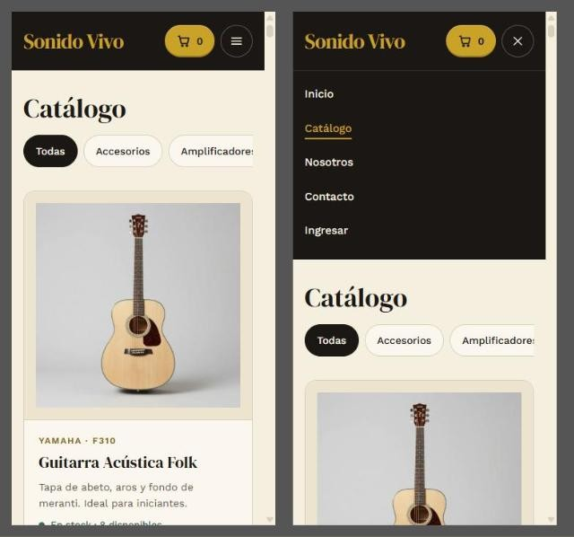{width=55%}

## 2. Comprar en la tienda (visitante y cliente)

### 2.1 Página de inicio

Muestra la presentación de la tienda, accesos por categoría y algunos productos
destacados. **Ver el catálogo** lleva a la lista completa.

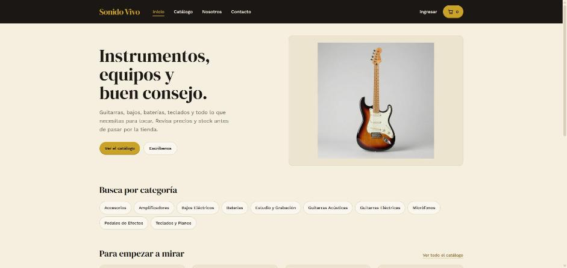

### 2.2 Catálogo y filtro por categoría

El **Catálogo** muestra los 51 productos con foto, marca, modelo, precio y disponibilidad:

- **En stock · N disponibles** (verde): hay unidades.
- **Últimas N unidades** (naranjo): quedan 3 o menos.
- **Agotado**: no se puede agregar al carrito.

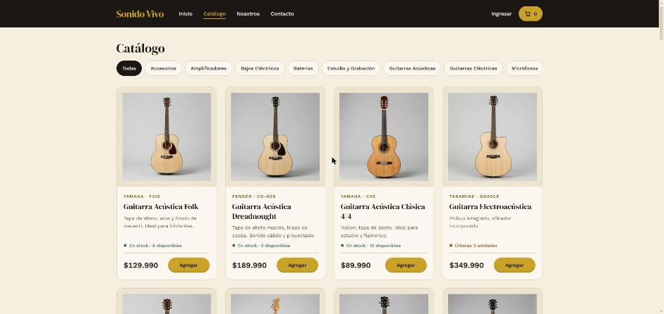

Para filtrar, hacer clic en una categoría (por ejemplo **Guitarras Eléctricas**). La
dirección cambia a `/catalogo?categoria=GE`, así que el filtro se puede guardar o compartir.
**Todas** quita el filtro.

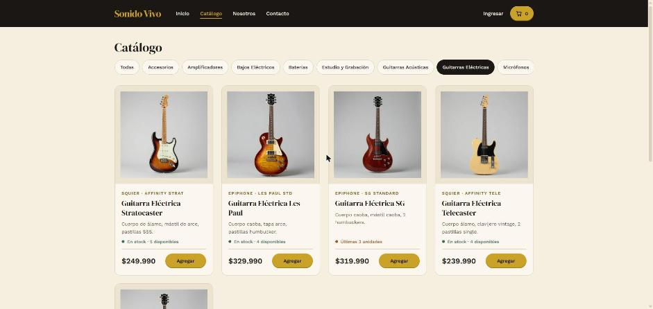

### 2.3 Ficha del producto

Al hacer clic en un producto se abre su ficha, con descripción, marca, modelo, categoría,
código, precio y stock. **Agregar al carrito** suma una unidad; el contador del carrito
de la barra superior aumenta.

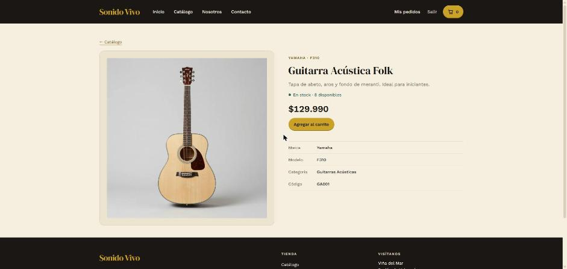

### 2.4 Carrito

El botón del carrito abre la lista de productos agregados:

- **– / +** cambia la cantidad. No deja pasar del stock disponible ni bajar de 1.
- **Quitar** saca el producto; **Vaciar** saca todos.
- Se muestra el subtotal de cada línea y el **Total**.
- **Comprar** lleva a finalizar la compra.

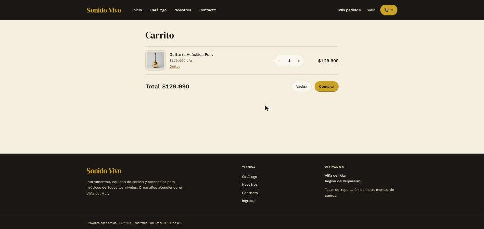

> El carrito se mantiene mientras se navega por la tienda. Se pierde si se recarga la
> página, porque se guarda en la memoria de la aplicación.

### 2.5 Crear una cuenta

Para comprar se necesita una cuenta. En **Ingresar → Crear cuenta** se completa nombre,
correo, contraseña (mínimo 8 caracteres y una mayúscula) y su repetición. Si falta un dato
o es inválido, el formulario lo indica bajo cada campo y no se envía. Si el correo ya está
registrado, el sistema lo avisa. Toda cuenta nueva es de tipo **Cliente**.

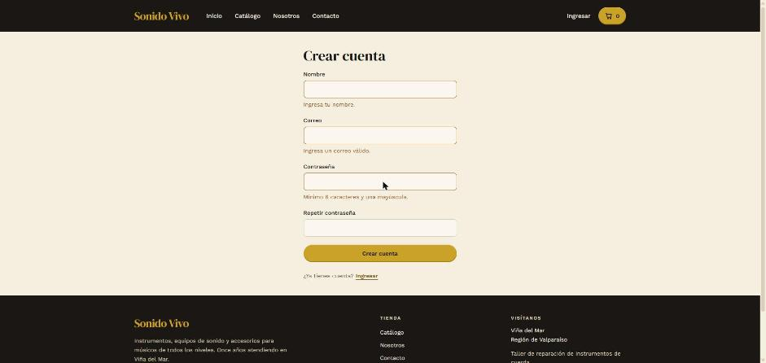

### 2.6 Iniciar sesión

En **Ingresar** se escribe el correo y la contraseña. Si son incorrectos aparece
"Credenciales incorrectas". Si son correctos, cada usuario llega a su página: el cliente a
**Mis pedidos**, el vendedor a **Pedidos** y el administrador al **Panel**. Si se había
intentado abrir una página protegida, vuelve a esa página.

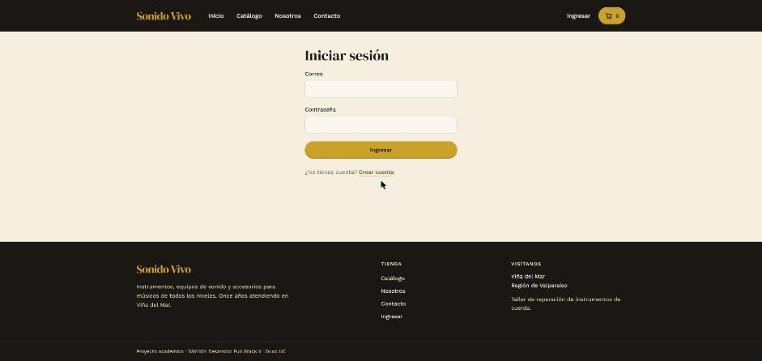

### 2.7 Finalizar la compra

En **Finalizar compra**: si no hay sesión, la página pide **iniciar sesión** y el
carrito se conserva. Con sesión:

1. Escribir **Nombre** y **Apellidos**. El pedido queda asociado al correo de la sesión.
2. Elegir la **Entrega**:
   - **Despacho a domicilio**: pide calle y número, región y comuna (la lista de comunas
     cambia según la región).
   - **Retiro en tienda (Viña del Mar)**: no pide dirección.
3. Revisar el **Resumen** a la derecha y presionar **Pagar**.

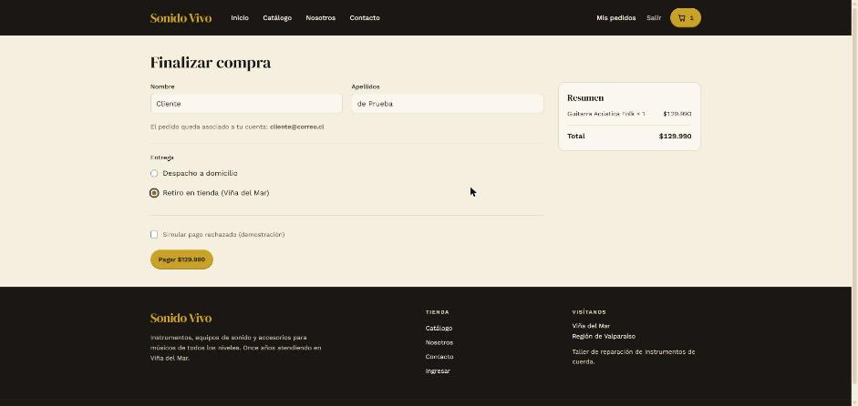

El precio de cada producto lo calcula el servidor, no el navegador. Si mientras tanto otro
cliente compró el último producto, aparece un aviso de **stock insuficiente** y no se
cobra nada.

> La casilla **Simular pago rechazado (demostración)** sirve para ver la pantalla de pago
> rechazado: no se crea el pedido y el carrito se conserva.

### 2.8 Resultado de la compra

Si el pago se aprueba se muestra el **número de pedido**, los datos de entrega y el
resumen. El carrito se vacía y el stock del producto baja.

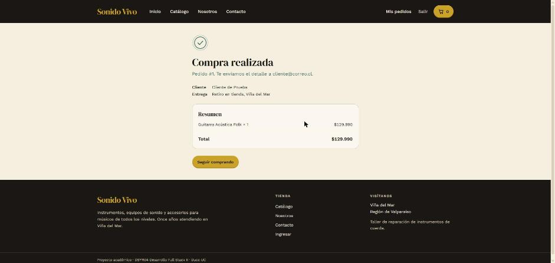

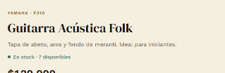

### 2.9 Mis pedidos

En **Mis pedidos** el cliente ve solo sus propios pedidos, del más reciente al más
antiguo, con fecha, productos, total y estado: **En preparación, Despachado, Entregado o
Cancelado**.

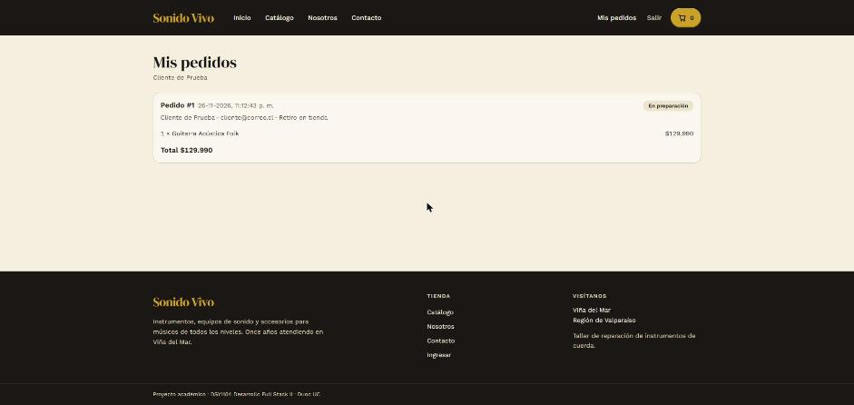

### 2.10 Sesión: recargar, vencimiento y salir

- **Recargar (F5)** no cierra la sesión: el sistema la vuelve a verificar con el servidor
  ("Verificando sesión…") y muestra la página.
- La sesión **dura 60 minutos**. Si venció o ya no es válida, al entrar a una página
  protegida el sistema lleva al inicio de sesión.
- La sesión se borra al **cerrar la pestaña** o al presionar **Salir**.
- Si el servidor no responde, aparece "No pudimos verificar tu sesión" con el botón
  **Reintentar**.

## 3. Gestionar pedidos (vendedor)

Al iniciar sesión, el vendedor llega a **Pedidos**, donde ve los pedidos de todos los
clientes. El selector **Estado** filtra la lista.

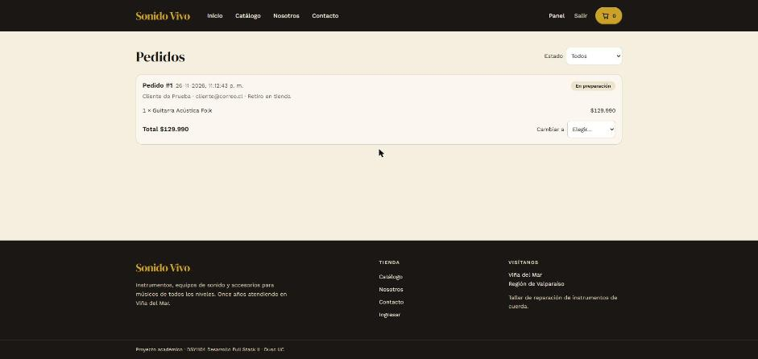

Para avanzar un pedido, elegir el nuevo estado en **Cambiar a**:

| Estado | Significado |
|---|---|
| En preparación | Estado inicial de todo pedido |
| Despachado | Salió de la tienda (o está listo para retiro) |
| Entregado | Recibido por el cliente. Estado final |
| Cancelado | Anulado; **el stock de sus productos se repone**. Estado final; pide confirmación |

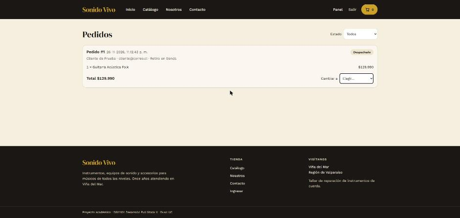

Los pedidos entregados o cancelados ya no se pueden cambiar. El vendedor **no** puede
entrar a la gestión de productos ni de usuarios: si lo intenta, ve **Acceso restringido**.

## 4. Administrar la tienda (administrador)

### 4.1 Panel

El **Panel** resume la cantidad de productos, cuántos tienen stock crítico (3 o menos) y
cuántos están agotados, con la lista **Por reponer**. A la derecha están los accesos a
Productos, Nuevo producto, Pedidos y Usuarios.

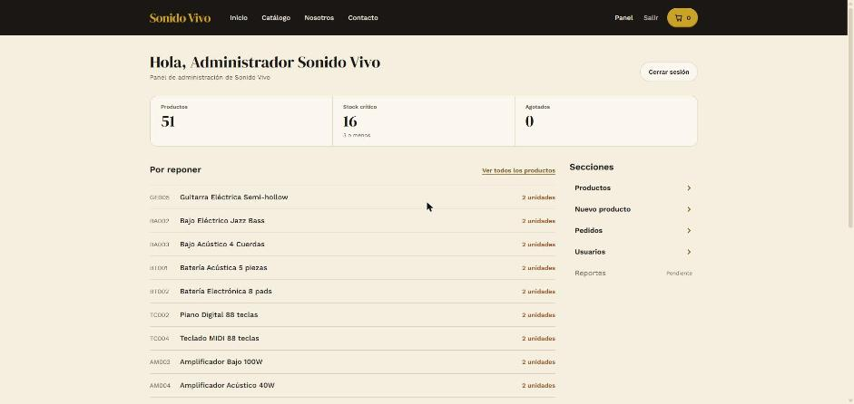

### 4.2 Lista de productos

**Productos** muestra la tabla completa con código, nombre, categoría, precio y stock
(los críticos se marcan). Cada fila tiene **Editar** y **Eliminar**.

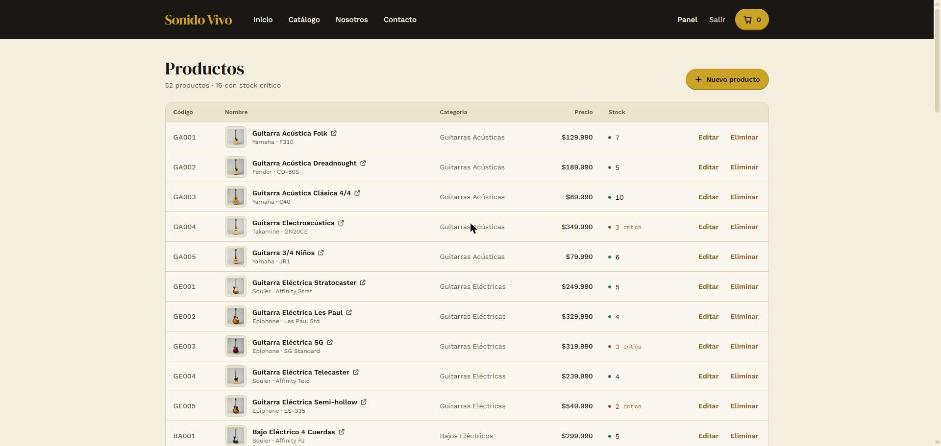

### 4.3 Crear un producto

**Nuevo producto** abre el formulario. Todos los campos son obligatorios:

| Campo | Regla |
|---|---|
| Código | Mínimo 3 caracteres; no puede repetirse |
| Nombre, Marca, Modelo | Obligatorios |
| Categoría | Una de las 10 categorías |
| Precio (CLP) | Entero mayor a 0 |
| Stock | Entero, 0 o más |
| Descripción | Mínimo 10 caracteres |

Si se presiona **Guardar** con datos faltantes o inválidos, cada campo muestra su error y
no se envía nada. El servidor vuelve a validar los mismos datos: si el código ya existe,
avisa que está repetido.

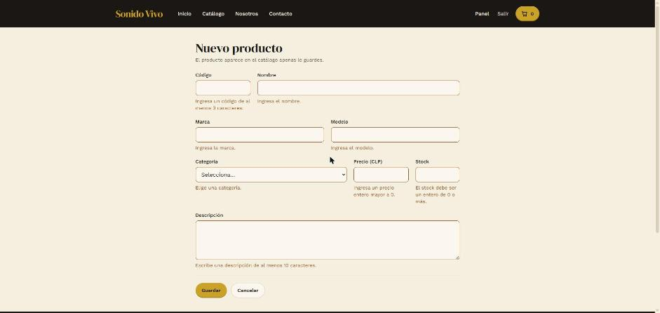

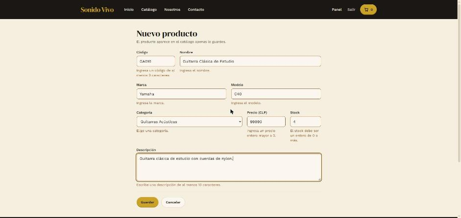

Al guardar, el producto aparece en la lista y en el catálogo público.

### 4.4 Editar un producto

**Editar** abre el mismo formulario con los datos actuales. El código no se puede
cambiar. Al guardar, el cambio se ve de inmediato en la lista y en el catálogo.

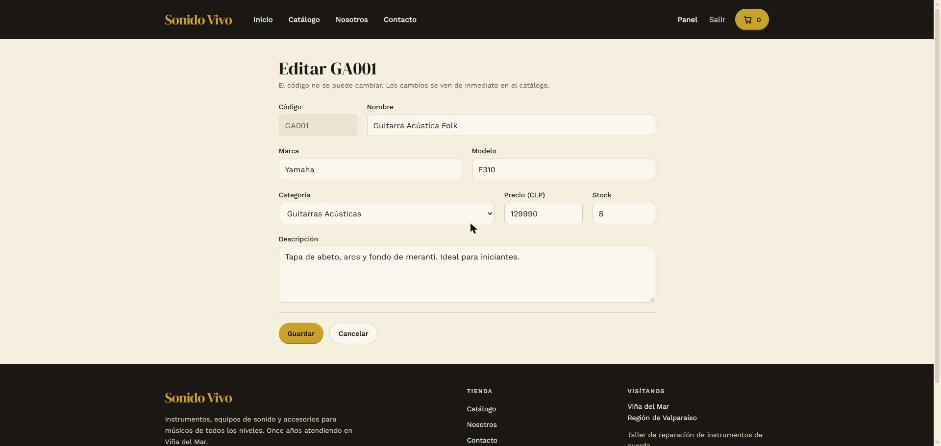

### 4.5 Eliminar un producto

**Eliminar** pide confirmación ("¿Eliminar GA010?"). Al aceptar, el producto desaparece de
la lista y del catálogo. Los pedidos antiguos que lo incluían no se modifican.

### 4.6 Usuarios

**Usuarios** lista todas las cuentas con su nombre, correo, rol y estado:

- **Rol:** el selector cambia el rol al instante (Cliente, Vendedor o Administrador).
- **Desactivar / Reactivar:** una cuenta desactivada no puede iniciar sesión, y si tenía una
  sesión abierta, deja de valer al recargar la página. No se borra, para conservar su historial.
- La fila propia dice **Tu cuenta**: el administrador no puede desactivarse a sí mismo.

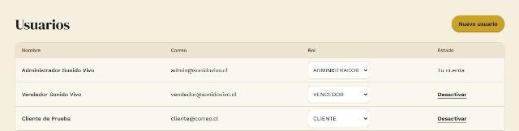

**Nuevo usuario** crea una cuenta con nombre, correo, contraseña y rol (por ejemplo, un
vendedor nuevo). La contraseña se guarda cifrada.

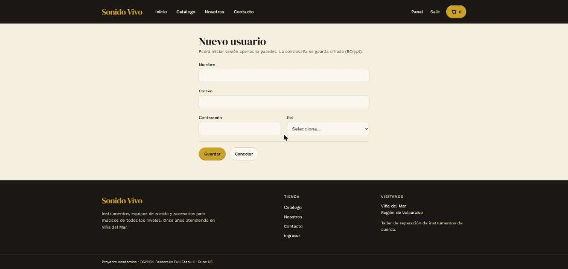

### 4.7 Pedidos

El administrador también tiene la página **Pedidos**, con las mismas funciones del
vendedor (sección 3).

## 5. Mensajes frecuentes

| Mensaje | Qué significa | Qué hacer |
|---|---|---|
| **Acceso restringido** | La cuenta no tiene el rol necesario | Ingresar con otra cuenta o volver |
| Redirige a **Iniciar sesión** | No hay sesión, venció o no es válida | Iniciar sesión otra vez |
| **Credenciales incorrectas** | Correo o contraseña equivocados, o cuenta desactivada | Revisar los datos |
| **No pudimos verificar tu sesión** / **No se pudo conectar con el servidor** | El backend está apagado o sin red | Encender el backend y presionar **Reintentar** |
| **Stock insuficiente de …** | Se pidió más de lo disponible | Bajar la cantidad en el carrito |
| Error bajo un campo | Dato faltante o inválido en un formulario | Corregir el campo indicado |

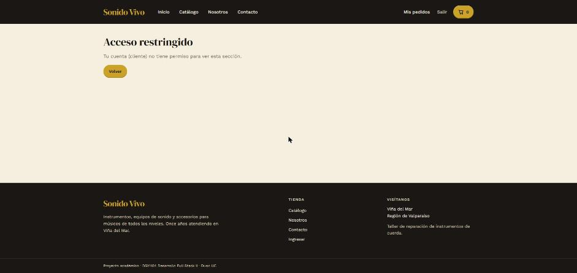

## 6. Documentación de la API (Swagger)

Para revisión técnica, cada microservicio publica su documentación interactiva:

| Microservicio | Dirección |
|---|---|
| Productos | http://localhost:8081/swagger-ui.html |
| Usuarios | http://localhost:8082/swagger-ui.html |
| Pedidos | http://localhost:8083/swagger-ui.html |

Para probar un endpoint protegido: en Usuarios, ejecutar `POST /auth/login` con una cuenta
de demostración, copiar el `token`, y pegarlo en el botón **Authorize** del microservicio.
Los endpoints con candado exigen sesión.

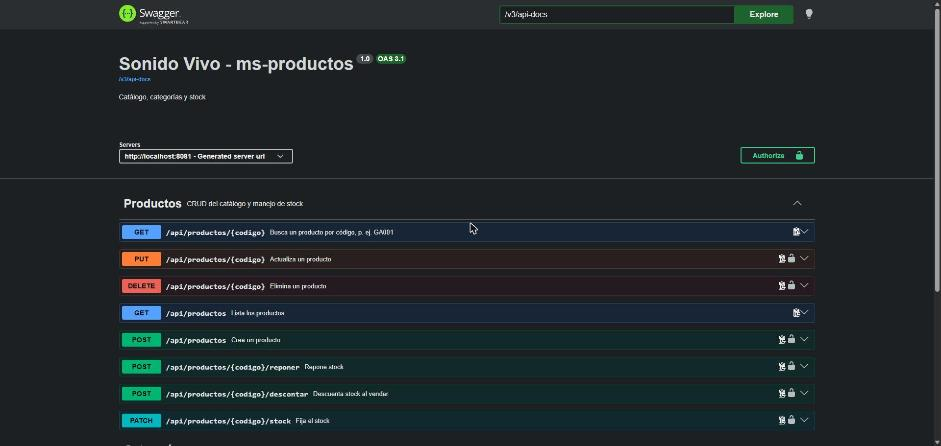

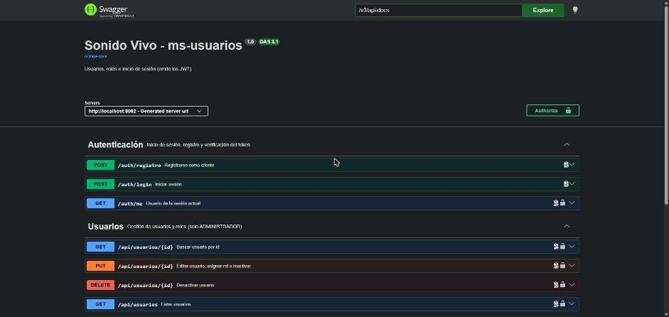
